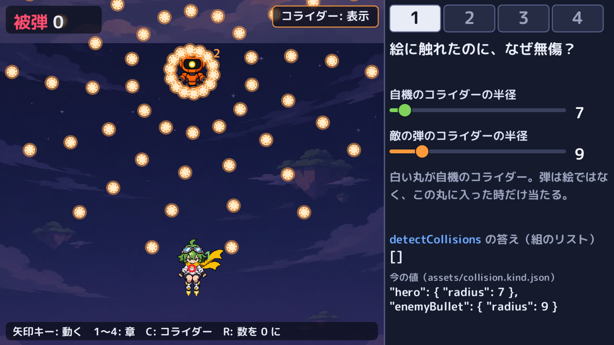
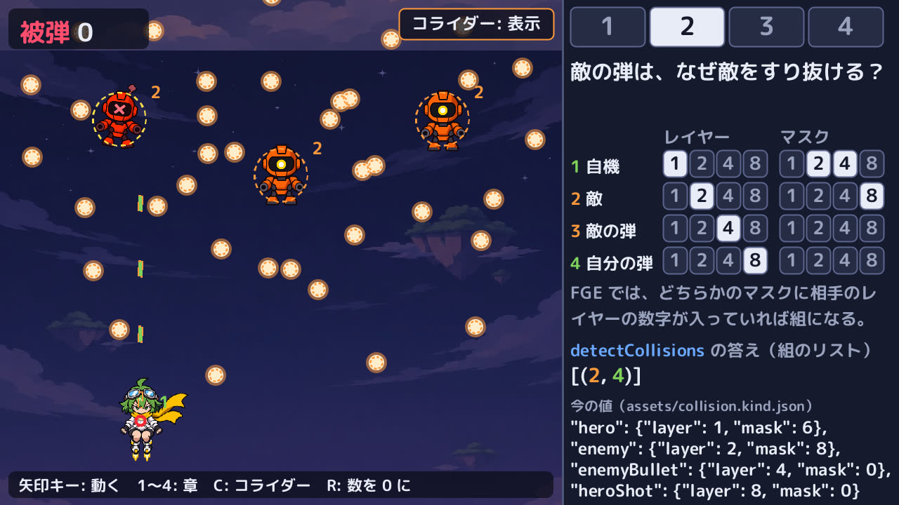
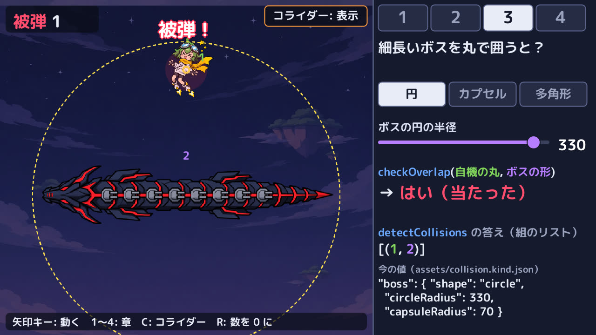
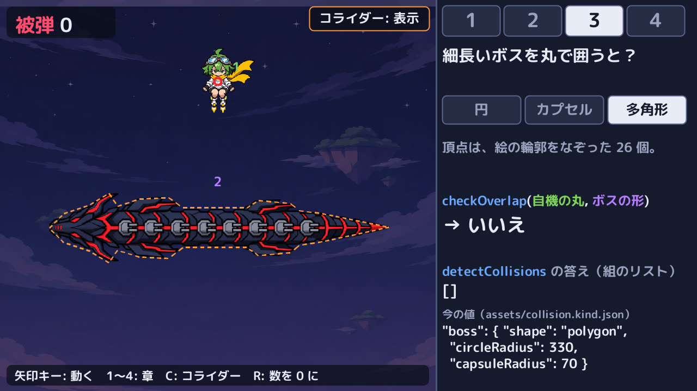
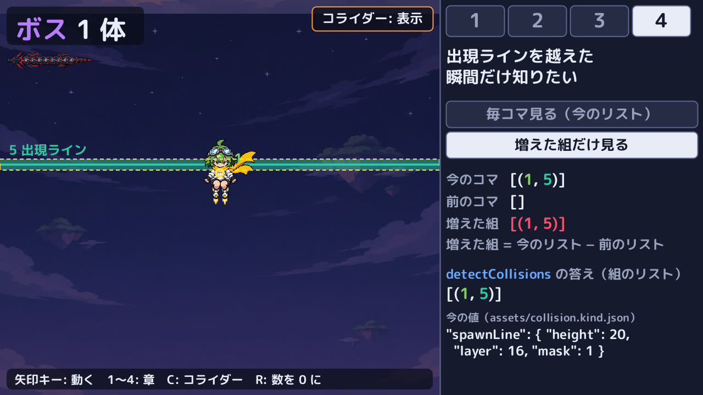

# 当たり判定サンプル（FGE）

YouTube の解説動画「当たり判定」（<VIDEO_URL>）で出てきた 4 つの話を、手で動かして確かめるためのサンプルです。
[FGE（Flix Game Engine）](https://github.com/ababup1192/flix_game_engine) で作っています。

- **ブラウザで遊ぶ**: https://ababup1192.github.io/fge-collision-sample/
- 左が弾幕シューティングの盤、右が値を変えるパネルです。番号と色は動画と同じです
  （1 自機・2 敵・3 敵の弾・4 自分の弾・5 出現ライン）。
- パネルの下には、`detectCollisions` が返した組（タプル）のリストと、今の値（JSON）が出ます。
  スライダーやチップを動かすと、JSON の数が変わるのが見えます。



## 動画の章と、試すこと

当たり判定のコードは [`src/Hits.flix`](src/Hits.flix) の 1 つのファイルにまとめてあります。

| 動画の章 | 試すこと | 該当コード |
|---|---|---|
| 1. 絵に触れたのに、なぜ無傷？ | 矢印キーで自機を動かし、弾を絵にかすらせる。白い丸（自機のコライダー）に入った時だけ「被弾」が増える。スライダーで半径を 2〜60 に変えると、当たりやすさが変わる | [コライダーの形・レイヤー・マスク `colliderOf`](src/Hits.flix#L47-L57) |
| 2. 敵の弾は、なぜ敵をすり抜ける？ | 敵の弾は敵の上を通っても組にならない。チップで「敵」のマスクに 4 を足すと、敵の弾と敵が組 (2, 3) になって敵が赤く光る。自分の弾（4）は敵に当たると消える | [組になるかの決まり `masksMatch`](src/Hits.flix#L59-L62)・[チップが書き換える所](src/World.flix#L235-L248) |
| 3. 細長いボスを丸で囲うと？ | 円・カプセル・多角形を切り替える。円のとき、自機をボスの絵から離れた円の隅に置いても `checkOverlap` が「はい」になる | [ボスを囲う形 `bossShapeOf`](src/Hits.flix#L71-L88)・[`checkOverlap`](src/Hits.flix#L90-L92) |
| 4. 出現ラインを越えた瞬間だけ知りたい | 自機を出現ライン（5）の上に置く。「毎コマ見る」ではボスが毎コマ増え、「増えた組だけ見る」では越えた瞬間に 1 体だけ増える。パネルに今のコマ・前のコマ・増えた組（赤）が並ぶ | [組のリスト `pairsOf`](src/Hits.flix#L96-L102)・[増えた組 `newPairs`](src/Hits.flix#L104-L107)・[ボスの数を数える所](src/World.flix#L185-L205) |

| 第 2 章 | 第 3 章（円） | 第 3 章（多角形） | 第 4 章（増えた組だけ見る） |
|---|---|---|---|
|  |  |  |  |

## 操作

| キー・マウス | すること |
|---|---|
| 矢印キー（WASD も可） | 自機を動かす |
| 1〜4・パネルの上のタブ | 章を切り替える（数とリストは 0 から数え直す） |
| C・盤の右上のボタン | コライダーの表示を切り替える |
| R | 被弾とボスの数を 0 に戻す |
| マウスでスライダーを引く・チップやボタンを押す | 値を変える |

## 手元で動かす

[FGE](https://github.com/ababup1192/flix_game_engine) を clone して、その場所を `local.mk` に書きます。

```sh
echo 'ENGINE := /path/to/flix_game_engine' > local.mk
make run      # ゲームを起動する
make debug    # 起動して、assets/collision.kind.json を保存したらすぐ反映する
make test     # テスト
make web      # ブラウザ版を build/web へ書き出す
make render SHOT=4-new   # 1 つの場面を debug/4-new.png へ描き出す（場面の名前は Makefile の SHOTS）
```

### JSON で値を変える

`make debug` で起動したまま [`assets/collision.kind.json`](assets/collision.kind.json) を書き換えて保存すると、
遊んでいる途中でもすぐ変わります（例: `"hero": { "radius": 40 }` にすると自機の丸が大きくなる）。
値は動画の FGE の表と同じです。

| 物 | 形 | layer | mask |
|---|---|---|---|
| 1 自機 | 円 半径 7 | 1 | 6（= 2 敵 + 4 敵の弾） |
| 2 敵 | 円 半径 38 | 2 | 8（= 自分の弾） |
| 3 敵の弾 | 円 半径 9 | 4 | 0 |
| 4 自分の弾 | 矩形 6×22 | 8 | 0 |
| 5 出現ライン | 矩形 盤の幅×20 | 16 | 1（= 自機） |

ブラウザ版ではファイルの保存を見張れないので、同じ値をパネルのスライダーとチップで変えます。

## ファイル

| ファイル | 中身 |
|---|---|
| [`src/Hits.flix`](src/Hits.flix) | 当たり判定の芯（コライダー・レイヤーとマスク・ボスの形・組のリスト・増えた組） |
| [`src/World.flix`](src/World.flix) | 遊びの状態と、1 コマ進める規則（自機・弾・数の数え方） |
| [`src/Tuning.flix`](src/Tuning.flix) | `assets/collision.kind.json` を読む |
| [`src/View.flix`](src/View.flix) | 盤の絵（背景・敵・弾・自機・コライダーの点線） |
| [`src/Panel.flix`](src/Panel.flix)・[`src/Slider.flix`](src/Slider.flix) | 右のパネル（タブ・スライダー・チップ・組のリスト・JSON） |
| [`src/Look.flix`](src/Look.flix) | 色（動画と同じ意味）と、字・点線を描く小物 |
| [`src/Game.flix`](src/Game.flix)・[`src/Main.flix`](src/Main.flix)・[`web/WebMain.flix`](web/WebMain.flix) | App の組み立てと、デスクトップ・ブラウザの入口 |
| [`src/render/SceneRender.flix`](src/render/SceneRender.flix) | 画面を PNG に描き出す（README の絵） |

## クレジット

- 絵（自機・敵・ボス・背景・アイコン）: ChatGPT の画像生成で作った物です。このリポジトリと一緒に再配布できます。
- フォント: M PLUS Rounded 1c（Rounded Mplus 1c Bold）— Copyright 2016 The M+ Project Authors。
  [SIL Open Font License 1.1](assets/OFL.txt)。
- エンジン: [FGE（Flix Game Engine）](https://github.com/ababup1192/flix_game_engine)
